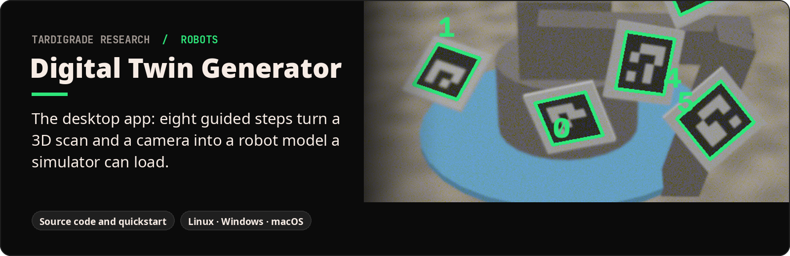
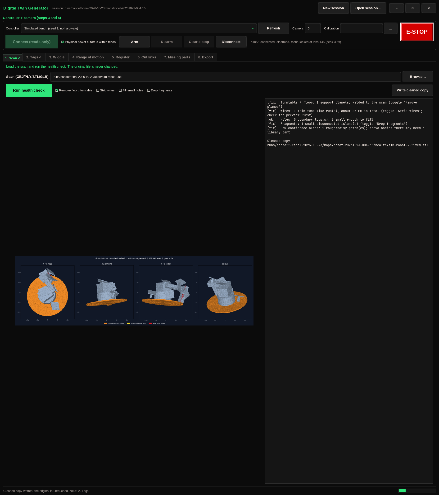
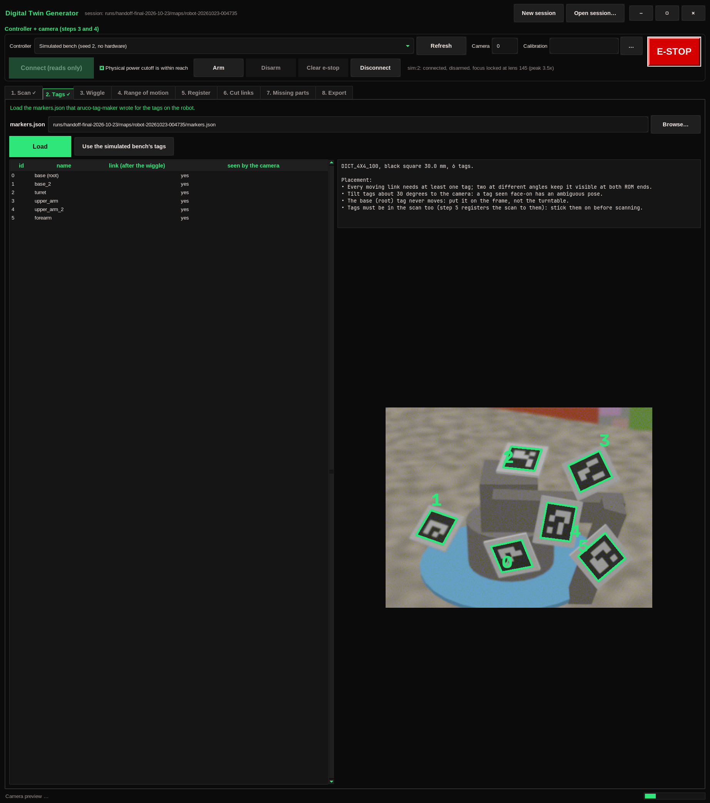
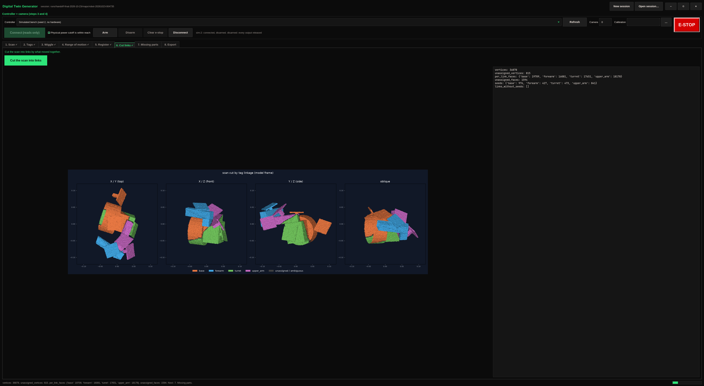
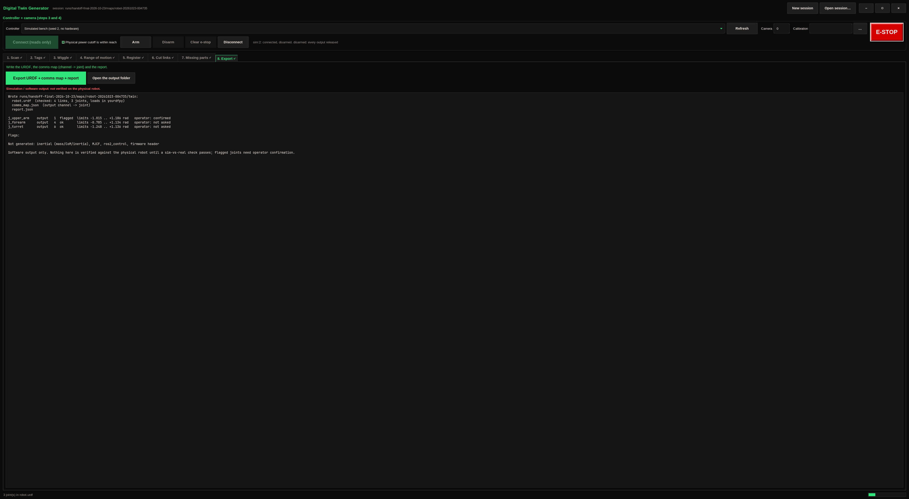

<p align="center"></p>

**What it is.** The source code of [Digital Twin Generator](https://github.com/tardigraderesearch/digital-twin-generator), a desktop app that turns a hand-built servo robot into a simulation model of that exact robot.

**What it does.** It walks you through eight steps, from a 3D scan and a camera watching the robot move to a URDF model file: which motor drives which joint, how far each joint can safely move, and the shape of every moving part.

**Why it matters.** Robots are trained in simulation before they touch the real world, and that normally needs CAD drawings and hand measurement. This app measures the robot itself, safely, in one guided session.


| 1. Scan check | 2. Find the tags | 6. Cut the scan into parts | 8. Export |
|---|---|---|---|
|  |  |  |  |

## Quickstart

```sh
git clone https://github.com/tardigraderesearch/digital_twin_generator && cd digital_twin_generator
python digital_twin_generator.py
```

The launcher checks Python and Tk, prepares a private `.venv`, asks before
installing dependencies, then opens the window. Nothing installs system-wide.
`python digital_twin_generator.py doctor` reports what the installation can do.

The window walks through eight tabs: scan, tags, wiggle, range of motion,
register, cut links, missing parts and export. The controller API, safety
controls, theme and servo database come from
[robo_prober](https://github.com/tardigraderesearch/robo_prober); the tag
manifest comes from [aruco-tag-maker](https://github.com/tardigraderesearch/aruco-tag-maker).
Motion requires explicit arming and a typed start pulse, E-STOP stays visible,
Escape stops motion, and the device enforces limits and a watchdog.

## Run on the virtual bench

```sh
make sim-env
sim/.venv/bin/python -m dtg gui --port sim:2
```

The virtual bench needs the sibling `robo_prober` and `aruco_tag_maker`
repositories and a C++ compiler for the firmware simulator. `make sim-env`
prepares a separate `sim/.venv`. The simulated camera renders the tags; select
the simulated controller before connecting.

Developer checks:

```sh
.venv/bin/python -m pytest -q     # includes GUI tests when a display is available
make sim-test                     # harness tests
SIM_SLOW=1 make sim-test          # also run the full virtual bench session
sim/.venv/bin/python -m sim gui-walk --seed 2 --screenshots docs/screenshots --out runs/gui-walk
```

The GUI walkthrough drives all eight tabs on the virtual bench and saves
[screenshots](docs/screenshots/).

## Saved work and CLI

Sessions save automatically under `~/digital_twin_generator_maps/`, or the
`DTG_MAPS_DIR` override. Reopen one with:

```sh
python digital_twin_generator.py gui --session /path/to/session
```

Each session keeps `session.json`, its tag manifest, camera observations,
health outputs and a `twin/` folder containing `robot.urdf`, meshes,
`comms_map.json` and `report.json`. Source scans remain unchanged.
The GUI and CLI share these session files. Use `--help` on `health`, `tags`,
`wiggle`, `rom`, `register`, `segment`, `parts` or `export` for individual steps;
`confirm` records answers to flagged channels and fitted joints.

## How the measurements work

### Wiggle (before ROM)

The wiring is unknown, so the wiggle comes first. For each IO channel, one at
a time, the controller (already armed by the operator) moves the pulse a
little: base, +delta, base, -delta, base. The default delta is 80 µs and it is
clamped to 150 µs. A channel that is not driven yet is first started at its
start pulse (robo-prober's explicit START). The wiggle ends at the start
pulse; if anything fails, the controller is stopped (all outputs released)
rather than moved back. Before the wiggle, `ArucoTracker.lock_focus()` sweeps
the lens and locks manual focus on the robot, so the tags stay sharp against
a busy background. The camera tracks every tag. `infer_linkage` then works
through these steps:

1. Measure each tag's motion relative to the root (base) tag. Motion counts
   when it beats a noise-scaled threshold.
2. Build each tag's **signature**: the set of channels that move it.
3. Group tags with the same signature that also move rigidly together. Each
   group is one link.
4. Assign each channel's child link: the link with the smallest signature
   that contains the channel. Its parent is the link whose signature is the
   same set minus that channel.
5. Take the direction from the sign of the rotation about the canonical
   axis, which is the axis with its largest component made positive.

It never guesses. Channels where nothing moves come back as `no_response`.
These cases come back as `needs_confirmation` with a reason:

- two channels that move the same child
- a link with no tag between two joints
- a whole link that was hidden during a wiggle
- tags that share a signature but do not move rigidly together

### ROM (camera watching the sliders)

The ROM step runs for each discovered joint. While the operator slides the
servo and presses Set ROM 1 / Set ROM 2, these are recorded and fitted:

- **Q_t**, the child pose in the parent frame, recorded for every settled
  capture
- **axis**: SVD of the rotation vectors of the motion since the reference
  pose
- **origin**: least squares for the fixed point, placed where the axis
  passes closest to the child
- **µs <-> angle**: a straight-line fit, giving rad/µs, direction and the
  zero pulse
- **terminal range 1 / 2**: the joint position at each ROM mark, plus the
  child pose and every child tag pose in the parent frame. These ranges
  become the URDF `lower` and `upper`.

Quality gates mark a joint as `flagged` and never drop it silently:

- hinge cleanliness, s1/s0 < 0.1
- pivot residual
- linearity of angle against pulse
- a measured position at a ROM mark that lags the fitted line, which catches
  end stops and windup
- wiggle and ROM disagreeing on axis or direction
- too little motion

Joint zero is the **reference capture**: the pose the robot was scanned in.

### Health check (bot1 result)

`python digital_twin_generator.py health /path/to/bot1.obj --out out/bot1-health`
takes about 18 s on 310k faces. It finds:

- **Turntable:** one support plane, the tilted disc, which is 40% of the
  surface. This includes the star feet and ridges outside the robot
  footprint and the skirt below the disc.
- **Wires:** three thin runs about 96, 59 and 47 mm long, each about 1.9 mm
  thick. They are the servo leads looping around the base.
- **Holes:** 61 boundary loops. 46 are small enough to fill and 15 are large
  openings (unscanned regions, gappy thin parts), which are reported only.
- **Fragments:** 7 small islands.
- **Low confidence:** 3 rough "mush" patches.

All fixes are opt-in and work on a copy:

`--fix planes wires holes fragments` writes `bot1.fixed.stl`. The fixes
remove 120k turntable faces and 23k wire faces, drop the shreds left behind,
and patch 46 holes with 932 faces, which are labelled `repaired`.
